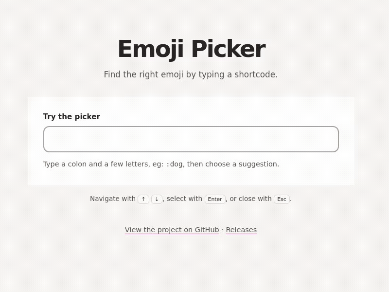

# Emoji Picker

[](https://github.com/rickycodes/emoji-picker/actions/workflows/test.yml)
[](https://app.codecov.io/gh/rickycodes/emoji-picker/tree/main)

A small vanilla JavaScript emoji picker. Type a shortcode such as `:dog` to see matching emoji, then choose one with the mouse or keyboard.



## Use

The project uses native browser ES modules and does not need a build step. Serve this directory over HTTP and open `index.html` (browsers generally block module imports from `file://`).

```js
import picker from "./src/index.js";
import fetchJSON from "./src/fetchJSON.js";

fetchJSON("./src/emoji.json").then((emoji) => picker(".input", emoji));
```

Press **Down** to activate the first suggestion, then use **Left/Right** to move across the suggestions. Press **Enter** to insert the active emoji; **Up** clears the active suggestion, and **Escape** dismisses the list. The picker also works with mouse clicks. Matching uses the shortcode immediately before the text caret, so it can be used in the middle of a sentence.

## Accessibility

The input is exposed as a **combobox** connected to a **listbox** of suggestions. Each suggestion has an accessible name based on its shortcode, and the active suggestion is announced while focus stays in the input. The keyboard controls above let users browse and select suggestions without a mouse.

`picker(selector, emojiData)` returns the input, suggestion list, and a `destroy()` method for removing the picker and its accessibility attributes.

## Tests

Run the behavior tests locally with:

```sh
npm install
npm test
```

GitHub Actions runs `npm test` on every push and pull request. The command also writes a local coverage report to `coverage/` and uploads it to Codecov in CI.

## Formatting

Format the project with Prettier, or check formatting without changing files:

```sh
npm run format
npm run format:check
```

## Record a demo

Install Playwright's Chromium browser once, then record the demo at 800 × 600:

```sh
npx playwright install chromium
npm run record:demo
```

The WebM recording is saved to `recordings/emoji-picker-demo.webm`. To create the GIF shown above with FFmpeg:

```sh
ffmpeg -i recordings/emoji-picker-demo.webm -filter_complex "[0:v]fps=12,scale=800:-1:flags=lanczos,split[s0][s1];[s0]palettegen[p];[s1][p]paletteuse" -loop 0 emoji-picker-demo.gif
```

## License

Copyright (c) 2016 Ricky Miller (@rickycodes). Released under the [MIT license](https://tldrlegal.com/license/mit-license).
